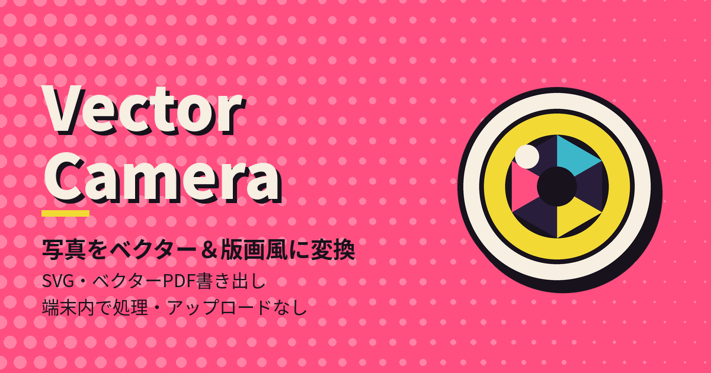

# Vector Camera

写真を **ベクターイラスト** や **シルクスクリーン（版画）風アート** に変換する、無料のブラウザアプリです。
画像は端末の中だけで処理され、サーバーには送信されません。インストール・会員登録は不要です。

**アプリを開く:** https://egoaid.github.io/Vector-Camera/

## できること

| モード | 内容 | SVG / PDF |
|---|---|---|
| **ベクター** | 写真の色を保ったまま、輪郭に沿った領域に分割したイラスト | 純粋なベクター（パスと塗りのみ） |
| **シルエット** | 被写体・中景・背景を単色の形にした、構図重視のグラフィック | 純粋なベクター |
| **カラー領域** | 色数を絞り、大きな色面にまとめたポスター風 | 純粋なベクター |
| **シルクスクリーン** | フラットな色面（ベクター）の上に、ハーフトーンやグレインで加工した写真を重ねる、ポップアート／レトロな版画風 | ベクター形状＋埋め込みラスター画像（写真部分はラスター） |

- 隣り合う領域は **同じ境界線を共有** するため、隙間や重なりのないきれいなベクターになります。
- 書き出し形式: **SVG**（Illustrator / Inkscape / Figma などで編集可）、**ベクターPDF**、**PNG**、**JPEG**。
- 詳細度・簡略化・滑らか↔シャープ・色数・版ズレ・グレイン・ハーフトーンなどをスライダーで調整できます。重い解析をやり直さず、必要な部分だけ再計算します。
- 被写体の判定が合わないときは「前景/背景を直す」で、領域をタップして切り替えられます。
- 使用中は画面が自動的にスリープしないよう、Screen Wake Lock API で抑制します（対応ブラウザのみ。設定でオフにできます）。
- **スタイル25種**: ポップ、レトロ・スリーブ、リソ、デュオトーン、モノクロに加え、ユナイト・ブルー、ガーデン、ラブ・ポップ、オリーブ、アース、フィールド、セピア・ストライプ、マルーン、ブームボックス、スタジアム、ラベンダー、スカイグリーン、ブルー＆ピーチ、クラフト、パーム、タイプライター、サンヒル、シアノ、ロイヤル、ティール＆ピンク。
- **🎲 ランダム生成**: 表現モード（ベクター／色分け／ハイブリッド／シルエット）・配色・形・トーン・ハーフトーン・質感・背景・被写体・線と縁取りまで、すべての設定の組み合わせから一括でランダムに決められます（ベクター×銀塩×エッチングなども出ます）。対象はチェックで選べ、結果が気に入らなければ編集パネル上部の「元に戻す」で一つ前へ戻せます。「画風の傾向」（エッチング／エングレービング／銀塩写真／モノクロ2階調／シルクスクリーン／ポップアート／ベクターイラスト／ポスター）は「その画風が出やすくなる偏り」で、他の組み合わせも出ることがあります（オフは全設定が対象の完全ランダム）。
- **コラージュ**: 複数の画像を選ぶと、ちぎった紙を重ねたもの・グリッド（繰り返し）・ストリップ・モザイクに配置します。ピースごとに配色を変えることもできます。SVG / PDF もベクターのまま書き出せます。
- **文字（ベクター）**: 最大3つの文字を入れられ、それぞれ別の書体（24書体）・大きさ・色・影・傾き（±90°まで）・ハーフトーン・かすれ・印刷の汚れを設定できます。編集画面の「文字1／2／3」タブで編集中の文字が分かり、表示中の文字はランプが点灯します。プレビュー上の文字枠をドラッグで動かし、●ハンドルで拡大縮小・回転できます。文字の初期状態はオフで、ランダム生成でも勝手にオンにはなりません（オンにした場合のみ、文章はそのままで書体・色・位置などをランダム化）。
- **ハーフトーン**: ドット／ライン／クロスハッチング（ペン画風）／エングレービング（紙幣風の波打つ細線とレース状のギロッシュ模様）／エッチング（レンブラントの銅版画のような、1本ずつ手で引いたような不揃いな線の重なり）から選べ、種類ごとに濃さ・立体への沿わせ方・ペンの揺らぎ・波の大きさなどを調整できます（写真・文字の両方）。エッチングは遠景を細く・近景を太くする「遠近の線の太さ」と、形に沿って引く「輪郭線」も調整できます（どちらも0でオフ）。
- **描き分け（エッチング）**: 写真の中の肌・髪・目・眉・鼻・口・空・葉・草・水などを自動で見分け、それぞれに合わせて線の長さ・向き・密度を変えます（顔は端末内の顔検出で目や口の輪郭も描きます）。「描き分け」を0にすると従来どおり一様な線になります。写真が白黒・暗い・顔が小さい場合は判定が弱くなります。
- **色タブ**: 配色・インクの色（ハーフトーン／トーン。ベクターでも変更可）・線の色を1か所で変更できます。「色の固定」にチェックを入れた色は、スタイルを選んだりランダム生成しても変わりません。
- **スタイル**: スタイルタブの先頭にランダム生成があります。エッチング／サンギーヌ／銀塩写真／シアノタイプ／シルクスクリーン／ポップアート／ベクター＋エッチング・銀塩・ハーフトーン など19種類の、配色だけでなく質感・ハーフトーン・線まで含めた全設定をワンタップで切り替えます（配色だけを変えたいときは「配色」を使います）。現在の設定は「マイスタイル」として名前を付けて保存でき、JSONファイルで書き出し・読み込みもできます。マイスタイルを選ぶと、保存した値がそのまま復元されます（「色の固定」中の色だけは現在のまま。そのときは通知します）。手動の前景/背景の修正は写真ごとの設定なので、スタイルには含まれません。
- **コラージュ**: 複数の写真を、人の手でちぎったような「手ちぎり（有機的）」などの縁でコラージュできます。ランダム生成はコラージュの全パラメータに反映されます。
- **輪郭線**: 領域の境界に線を重ね、少しずらした線（版ズレ）を添えることもできます。
- **ラスター部分のベクター化**: シルクスクリーンの粒子・写真インクを、トレースして本物のパスに変換できます（SVG / PDFが完全にベクターになります。時間がかかります）。
- **ポスター用ラスター書き出し**: A4〜A1（300dpi）や12000pxのPNGを、分割描画で書き出せます。ベクター部分は大きなサイズでもシャープなままです。
- カメラ: 画面いっぱいの映像の上にシャッターとカメラ切替が重なって表示され、縦・横どちらの向きでも撮影できます。セルフタイマー（3/5/10秒）付き。コラージュ用には **連写（枚数・間隔を選択）** と、落ち着いて何枚も撮れる撮影トレイ（不要な写真は✕で削除）があります。画面下の「写真」ボタンからいつでも写真の入口（撮影・画像選択・コラージュ用の複数枚）に戻れます（編集内容は「← 編集に戻る」で再開できます）。
- 編集画面: 画面下のアイコン（スタイル／調整／ハーフトーン／輪郭線／文字／ランダム、右端が書き出し）をタップするとその編集パネルが開きます。スマホではプレビューを大きく表示したまま調整できます（アイコンの再タップでパネルを閉じる／パネル上部の矢印で元に戻す・やり直し／写真の入口・比較・前景/背景の修正などは右上の「⋯」メニュー）。
- プレビュー: ピンチ操作（パソコンではマウスホイール）で拡大縮小、ドラッグで移動できます。⛶で全画面表示、右下のハンドルで枠の大きさを変更、✥で好きな位置に移動（ピクチャーインピクチャー風。⤒で元の位置へ）。拡大しても枠の大きさは変わらないので、パラメータが隠れません。iPhoneでも画面全体は拡大されません。
- 書き出し: SVG・ベクターPDF・PNG・JPEGに加え、処理能力の低い端末向けの「軽量PNG／軽量JPEG」（長辺1280px）があります。
- 「比較」の境界線は、画像の上をなぞって左右に動かせます。
- 日本語／English。

## 使い方

1. 最初の画面（写真の入口）で、「カメラで撮る」「画像を選ぶ」「撮影してコラージュ」「画像を選んでコラージュ」のどれかをタップします（カメラの許可は、カメラのボタンを押したときだけ求めます）。
2. 自動で領域が分割され、結果が表示されます。モードとスタイルを選び、スライダーで調整します。
3. 「書き出し」から SVG / ベクターPDF / PNG / JPEG を保存します。

### トーンとエッチングの設定（v0.9）
- 「形・質感」タブの「トーン」: **銀塩写真**（黒点・白点・コントラスト・階調カーブ・粒子の強さ／大きさ／荒れ・セピア／セレン調色）と、**完全な2階調**（インクと紙の2色だけ。しきい値・黒の割合・局所しきい値・細部・輪郭・ノイズ除去・崩し）を選べます。ハーフトーンは、どちらにも重ねられます（重ね具合を調整）。
- エッチングでは、線を「形に沿わせる」（陰影の曲がり）と「流れに沿わせる」（毛流れ・質感の向き）を別々に調整できます。顔が検出できたときは、肌・頬・目・眉・鼻・唇・髪ごとの描き分けの強さも変えられます。
- 顔検出は MediaPipe Face Landmarker（同梱・端末内）を使います。「オフ」にもできます。使えないときや顔が見つからないときは、顔パーツなしで独自の被写体解析だけで描きます。

ヒント: 動作が重いときは、スタート画面の「解析サイズ」を「軽量」にしてください。ホーム画面に追加すると、アプリのように起動できます。

## プライバシー

- 撮影・選択した画像は、お使いのブラウザの中でのみ処理されます。アップロード、アカウント、広告、解析用の通信はありません。
- 解析もすべて端末内で行います。外部サービスへの送信はありません。エッチングの顔検出（MediaPipe Face Landmarker）は同梱のファイル（約17MB）を初回に読み込み、以降は保存データを使います。追加のダウンロードやインストールは不要です。
- 一度読み込んだ後は、オフラインでも動作します。

## 動作環境

- iPhone（Safari）、Android（Chrome）、デスクトップの最近のブラウザ。
- カメラ撮影にはブラウザのカメラ許可が必要です（許可できない場合は「画像を選ぶ」を使えます）。
- 画面スリープ抑制は、Screen Wake Lock API に対応したブラウザ（iOS 16.4 以降の Safari、Chrome など）で働きます。

## 制限事項（正直な説明）

- 自動の領域分割は完璧ではありません。写真によっては境界が合わないことがあり、その場合は「詳細度」「輪郭の感度」や、手動の「前景/背景を直す」で調整してください。
- 領域分割は色と輪郭を手がかりにしたもので、物体を意味的に理解するものではありません。被写体判定は位置・コントラスト等に基づく推定です。
- シルクスクリーンモードの SVG / PDF では、初期設定では写真由来のインク層はラスター画像です。「ラスター部分もベクターに変換」をオンにすると完全なベクターになりますが、時間とファイルサイズが増え、細かな階調は段階的な色面になります。
- コラージュでは、各画像の前景/背景は自動判定のみです（手動修正は1枚の画像のときだけ）。画像を変えるとピースの解析をやり直すため、スライダー操作後に少し待つことがあります。
- 文字は同梱フォントの英数字・記号のみです。日本語の文字は表示されません。
- ポスター用の超大サイズは、端末のメモリと時間に依存します（極端に大きいと失敗することがあります）。
- 高解像度や「高精細」設定は、古い端末ではメモリ不足になることがあります。
- 紙の質感（ノイズ）は PNG / JPEG と画面表示にのみ反映され、SVG / PDF には含まれません。

## 書き出したファイルの確認方法

- **SVG**: ブラウザや Inkscape / Illustrator で開き、拡大してもエッジがシャープなこと、パスを選択できることを確認します（ベクター／シルエット／カラー領域モードでは、画像オブジェクトは含まれません）。
- **PDF**: PDFビューアで最大まで拡大して、輪郭がぼやけないことを確認します（シルクスクリーンモードでは写真インク部分のみラスターです）。

## クレジットとライセンス

© 2026 egoaid. All rights reserved.

同梱: [MediaPipe](https://github.com/google-ai-edge/mediapipe)（Tasks Vision の実行ファイルと Face Landmarker のモデル。Apache-2.0、vendor/mediapipe に無改変で同梱。ライセンス全文は vendor/mediapipe/LICENSE、詳細は vendor/mediapipe/NOTICE.txt）。顔のパーツ検出にのみ使い、端末内で動作します。

同梱フォント（文字の輪郭化のみに使用）: Anton、Bebas Neue、Archivo Black、Abril Fatface、Shrikhand、Bungee、Pacifico、Caveat、Reenie Beanie、Covered By Your Grace、Gochi Hand ほか（SIL Open Font License 1.1）、Permanent Marker、Rock Salt、Special Elite、Homemade Apple（Apache License 2.0）。各ライセンスは `fonts/LICENSES.txt` にあります。

プリセットの配色はこのプロジェクトのオリジナルです。特定のアーティストやレーベルとは関係ありません。

---

## English

Vector Camera is a free, privacy-first web app that turns photos into editable vector art (native SVG and true vector PDF) and screen-print style hybrid artwork. Everything runs in your browser - images are never uploaded. Modes: Vector, Silhouette, Color regions, Silkscreen (flat vector colour blocks + processed photo "ink" layers). Pure-vector modes export genuine paths and fills; the Silkscreen mode embeds raster ink layers clipped by vector paths (PNG / JPEG export the flattened result). The optional face detection used by the etching style (bundled MediaPipe Face Landmarker, about 17 MB, loaded once) also runs on your device. The screen is kept awake while you use the app (Screen Wake Lock API, where supported).

© 2026 egoaid. All rights reserved.
